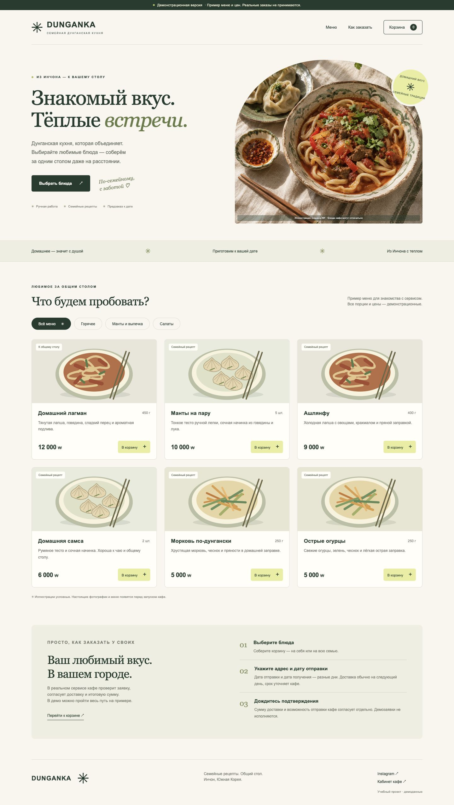
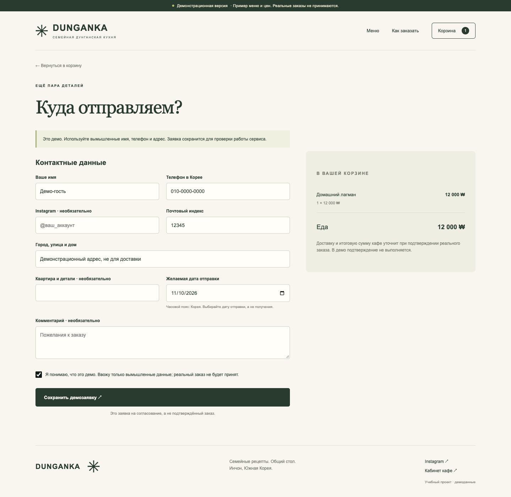
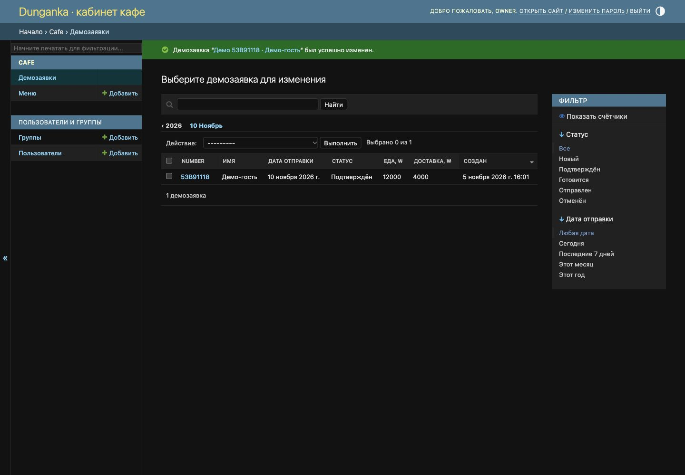

# Dunganka · family kitchen, connected

**Live demo:** https://dunganka.onrender.com/ · [CI checks](https://github.com/Silviusr/dunganka/actions)

A working Django ordering demo for a family-owned Dungan restaurant in Incheon, South Korea. It turns a back-and-forth Instagram conversation into a structured preorder: dishes, quantities, contact details, address and dispatch date, followed by staff confirmation.

**Portfolio demo, not a live ordering service.** The menu uses 19 cafe-supplied food photographs and prices transcribed from its November 2026 menu (22 options including smaller portions and half a flatbread). Use fictional customer details only. No payments, notifications or fulfilment are performed. Unidentified photographs, group shots and unverified dishes are excluded.



## What works

- Responsive Russian menu with categories and KRW prices.
- Session cart: add, change quantity, remove; unavailable dishes cannot be ordered.
- Server-validated checkout with Korean postcode and dispatch-date validation (tomorrow to 60 days, Asia/Seoul).
- Persistent orders and immutable line snapshots: later menu edits do not rewrite old orders.
- Server-calculated totals; delivery remains unknown until staff enters a fee, including zero for free delivery.
- Transactional creation with a unique submission token; retrying a completed form returns the original receipt.
- Session-private receipt with an unguessable UUID; another browser cannot view it.
- Staff-only Django admin: search, dispatch-date/status filters, delivery fees, statuses, prices and availability.
- CSRF protection, template escaping and environment-based deployment settings.

## Run locally

Python 3.13 is the tested version. From this directory:

```sh
python3 -m venv .venv
source .venv/bin/activate
pip install -r requirements.txt
python manage.py migrate
python manage.py seed_demo
python manage.py createsuperuser
python manage.py runserver 127.0.0.1:8000
```

Open http://127.0.0.1:8000/ and http://127.0.0.1:8000/admin/. Choose your own staff username and password; the repository ships no accounts or database. `seed_demo` only creates missing dishes, so rerunning it preserves staff edits.

The local defaults enable DEBUG and use a development-only signing key. They are restricted to localhost hostnames. Plain Python does **not** automatically load `.env`; set exported environment variables yourself when using Gunicorn outside Docker.

## Try the workflow

1. Add lagman and a flatbread, open the cart and change a quantity.
2. Enter fictional details, a five-digit postcode and a future dispatch date. A syntactically valid test phone is `010-0000-0000`.
3. Confirm the demo checkbox and save the request. Note its number and food subtotal.
4. Sign into `/admin/`, open the order, set its delivery fee and status.
5. Refresh the receipt in the original browser. A separate browser/session receives 404.
6. Change a dish price in admin: the earlier order retains its original unit price.





## Verify

```sh
python manage.py collectstatic --noinput
python manage.py check
python manage.py makemigrations --check --dry-run
python manage.py test -v 2
```

The suite contains integration tests covering totals, snapshots, duplicates, receipt privacy, CSRF, date bounds, invalid quantities/contacts, unavailable and deleted dishes, cart updates, category filtering, seed idempotency and staff editing. GitHub Actions is configured to run these checks; the latest result is available on the repository Actions tab.

## Architecture

```text
Browser → Django views + forms → transactional order service → SQLite
             ↓                         ↓
        session cart          Order + OrderLine snapshots
             ↓                         ↓
      private receipt           staff-only Django admin
```

| File | Responsibility |
| --- | --- |
| `cafe/models.py` | Dishes, orders and price/name snapshots |
| `cafe/services.py` | Current cart pricing and atomic, idempotent creation |
| `cafe/forms.py` | Contact and Seoul dispatch-date validation |
| `cafe/views.py` | Session cart, checkout, receipt authorization |
| `cafe/admin.py` | Staff menu editing and order processing |
| `cafe/tests.py` | Integration regressions through the actual routes/admin |
| `config/settings.py` | Local defaults and environment-based HTTPS settings |

Django templates and small progressive JavaScript keep ordering usable without a frontend build step. JavaScript disables the submit button while saving; server-side token uniqueness remains the duplicate safeguard. SQLite makes the demo easy to run. This is a single-restaurant service, not a multi-tenant SaaS.

## Docker

```sh
cp .env.example .env
# Set DJANGO_DEBUG=1 for HTTP localhost and replace DJANGO_SECRET_KEY.
docker compose up --build
# In another terminal:
docker compose exec web python manage.py createsuperuser
```

Compose binds only to localhost and keeps SQLite in a named volume. The container uses an unprivileged user and one Gunicorn worker. The image can be used behind an HTTPS ingress. A native Python Render deployment is also configured in `render.yaml`.

For an HTTPS deployment, use `DJANGO_DEBUG=0`, a strong unique `DJANGO_SECRET_KEY`, your hostname in `DJANGO_ALLOWED_HOSTS` and your HTTPS origin in `DJANGO_CSRF_TRUSTED_ORIGINS`. Production settings enforce secure cookies, HTTPS redirects and HSTS. Configure trusted proxy HTTPS handling only for infrastructure you control; the app does not blindly trust forwarded headers. Verify against those settings with `python manage.py check --deploy`. Persist and back up the database; do not run multiple replicas sharing this SQLite file. Docker configuration is supplied; the image was not built in this development environment.

## Scope and next steps

Public business launch still needs the actual menu, verified photos/prices, dispatch rules, storage/packaging guidance, contact and privacy information from the restaurant, operational hosting, backups, monitoring and abuse controls. For sustained public traffic, migrate to PostgreSQL and evaluate concurrency/load. There is no online payment, carrier integration, automated Instagram messaging, customer account or public order-tracking endpoint. Receipts are tied to the originating session and are not a recovery mechanism.

The restaurant name and social link identify the intended business; the demo visual direction is a proposal, not a claim to reproduce its existing brand. Source code and project illustrations were assembled with AI assistance; review and understand the implementation before describing it in an interview. Third-party packages retain their own licenses. No additional license for the restaurant brand is granted.

See the [project brief](docs/superpowers/specs/2026-11-05-dunganka-design.md) and [implementation plan](docs/superpowers/plans/2026-11-05-dunganka.md).

## Render hosting

`render.yaml` declares a free Python web service and free PostgreSQL in Singapore. The database outlives web-service restarts, but Render Free Postgres expires after **30 days**. Render Free web services sleep after 15 minutes idle; the next visitor may wait about a minute. This is a portfolio demo, not business production hosting.

The native service uses the latest Python 3.13 patch, installs requirements and collects static assets at build time. At startup it applies migrations, seeds missing demo dishes and runs Gunicorn on `$PORT`. `DATABASE_URL` selects PostgreSQL; a Render deployment refuses to fall back to ephemeral SQLite. Render sets its external hostname automatically; production hosts and CSRF origins include it. `DJANGO_TRUST_PROXY=1` must be set only when the ingress controls `X-Forwarded-Proto`, as Render does. `/healthz/` checks the database and returns 200 or 503 without exposing details.

For the first staff account, set a unique `DJANGO_SUPERUSER_USERNAME` and strong `DJANGO_SUPERUSER_PASSWORD` as **secret environment variables** before startup. `bootstrap_admin` creates that account only when missing; later startups never reset its password or elevate an existing username. No production credentials are committed. The localhost staff account is separate from the hosted database.

Official references: [Django on Render](https://render.com/docs/deploy-django), [Free tier limits](https://render.com/docs/free), [Python runtime selection](https://render.com/docs/python-version).

The current service is connected through its public repository URL, so updates are released manually through Render after CI passes. For automatic deploys, first connect the repository through Render’s Git provider integration.
